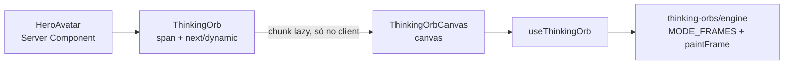

# Integração no projeto

## Contexto
O orb é o avatar da seção hero. O projeto usa só a engine da `thinking-orbs`, com canvas próprio; o motivo está em [[orbs-docs/tamanho-customizado]]. O formato da integração segue as regras do `.claude/CLAUDE.md`:

| Regra do CLAUDE.md | Efeito na integração |
|---|---|
| `'use client'` só no menor componente folha | só o wrapper e o canvas são Client Components; o hero continua Server Component |
| Bibliotecas de efeito com `next/dynamic` + `ssr: false` | a engine vai num chunk separado, carregado só no client |
| Sem `style={}` inline | o tamanho vem de classe Tailwind e o canvas se mede |
| Lógica em hooks; `useEffect` só para sistemas externos, sempre com cleanup | o loop de desenho e os observers ficam em `useThinkingOrb` |
| Dark mode por variáveis CSS e `prefers-color-scheme` | o tema do orb segue a mesma media query |

## Conteúdo principal

### Arquivos
| Arquivo | Papel |
|---|---|
| `src/shared/components/ui/thinking-orb.tsx` | `ThinkingOrb`, o componente público: um `` com `size-16` por padrão mais o `className` recebido; carrega o canvas via `next/dynamic` com `ssr: false` |
| `src/shared/components/ui/thinking-orb-canvas.tsx` | `ThinkingOrbCanvas`: `<canvas>` com `block size-full`. Com `aria-label` vira `role="img"`; sem ele fica `aria-hidden` |
| `src/shared/hooks/use-thinking-orb.ts` | `useThinkingOrb`: medição, escolha de preset, densidade e loop de desenho |
| `src/shared/hooks/use-media-query.ts` | `useMediaQuery`: `matchMedia` via `useSyncExternalStore`, usado para tema escuro e movimento reduzido |
| `src/features/hero/components/hero-avatar.tsx` | uso: `<ThinkingOrb state="composing" className="size-37.5 lg:size-100" />` (150px no celular, 400px a partir de 1024px), dentro de um anel com `p-5` |

### Fluxo

`useThinkingOrb`, em ordem:
1. O `ResizeObserver` mede o canvas: `tamanho = min(largura, altura)`, e o buffer passa a `tamanho × DPR` (DPR no máximo 2).
2. `resolveOrb(state, tamanho)` escolhe o preset mais próximo e aplica a densidade (regra em [[orbs-docs/tamanho-customizado]]).
3. A cada frame: `paintFrame(ctx, MODE_FRAMES[mode](tamanho, t, opts), dark)`, com `t = segundos × velocidade do preset × speed`.
4. O loop só roda com o canvas visível (`IntersectionObserver`) e a aba ativa (`visibilitychange`).
5. Com `prefers-reduced-motion: reduce`, desenha um frame fixo (`t = 0,6`, como a biblioteca) e não anima.
6. O efeito roda de novo quando mudam `state`, `speed`, o tema ou a preferência de movimento. O cleanup cancela o `requestAnimationFrame` e desconecta os observers.

### API do `ThinkingOrb` do projeto
| Prop | Padrão | Uso |
|---|---|---|
| `state` | `'working'` | um dos 9 estados (lista em [[orbs-docs/biblioteca-thinking-orbs]]) |
| `speed` | `1` | multiplicador de velocidade |
| `aria-label` | — | use quando o orb comunica um status (ex.: carregando); sem ele, o orb é decorativo |
| `className` | `size-16` | tamanho e posição via Tailwind |

### Como alterar as configurações
| Quero mudar | Onde | Como |
|---|---|---|
| Tamanho | `className` no ponto de uso | `size-N` = N × 4px: `size-37.5` = 150px, `size-50` = 200px, `size-100` = 400px. No hero hoje: `size-37.5 lg:size-100`. O anel acompanha sozinho (padding `p-5`) |
| Breakpoint do tamanho de desktop | prefixo da classe em `hero-avatar.tsx` | `lg:` vale a partir de 1024px; `md:` a partir de 768px; `xl:` a partir de 1280px |
| Animação | prop `state` | ex.: `state="searching"` |
| Velocidade | prop `speed` | `0.5` = metade, `2` = dobro |
| Densidade acima de 64px | `DENSITY_GROWTH` em `use-thinking-orb.ts` | maior = mais pontos; `0` = mesma densidade do preset de 64 |
| Faixas de preset (20/32/64) | `nearestPreset` em `use-thinking-orb.ts` | limites atuais: `< 26` → 20, `< 45` → 32 |
| Cor dos pontos | não exposta | passar `{ r, g, b }` (0–255) como 4º argumento de `paintFrame`. Só aceita RGB, então duplicaria o token `oklch` |
| Raio dos pontos | não exposto | aplicar `scaleRadii(opts, fator)`, exportado de `thinking-orbs`, dentro de `resolveOrb` |
| Pausar | não exposto | o componente da biblioteca tinha `paused`; aqui seria uma condição a mais em `syncLoop` |

> [!warning] A classe de tamanho precisa aparecer inteira no código
> O Tailwind só gera classes que encontra escritas no código-fonte. ``className={`size-${n}`}`` não funciona; escreva a classe completa (`size-37.5`, `lg:size-100`).

> [!note] De onde vem o `scaleCounts`
> `scaleCounts` é importado de `thinking-orbs` (entrada principal) porque `thinking-orbs/engine` não o exporta. A entrada principal também contém o componente React, que pode ser eliminado por tree-shaking (`sideEffects: false`). Isso não foi conferido no bundle.

## Decisões / Soluções
- O tema do orb segue só `prefers-color-scheme`, como o CSS do site. Se o site ganhar um seletor manual de tema com a classe `.dark`, o `useThinkingOrb` precisará observar essa classe; hoje não observa.
- A dependência é `thinking-orbs@^0.3.2`. Ao atualizar, confira se `MODE_FRAMES`, `paintFrame`, `resolvePreset` e `scaleCounts` mantêm a assinatura: são APIs públicas, mas a biblioteca ainda está na 0.x.

## Relacionados
- [[orbs-docs/orbs-docs_index]] — índice de orbs
- [[orbs-docs/biblioteca-thinking-orbs]] — API e funcionamento da engine
- [[orbs-docs/tamanho-customizado]] — por que o projeto desenha pela engine
